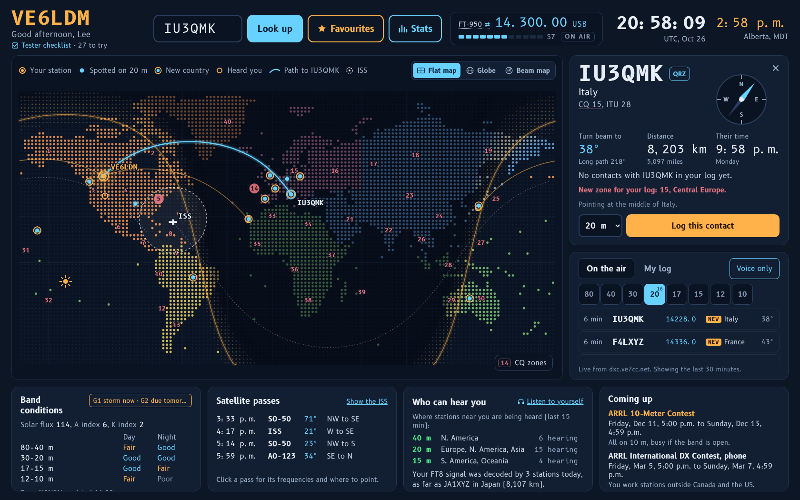
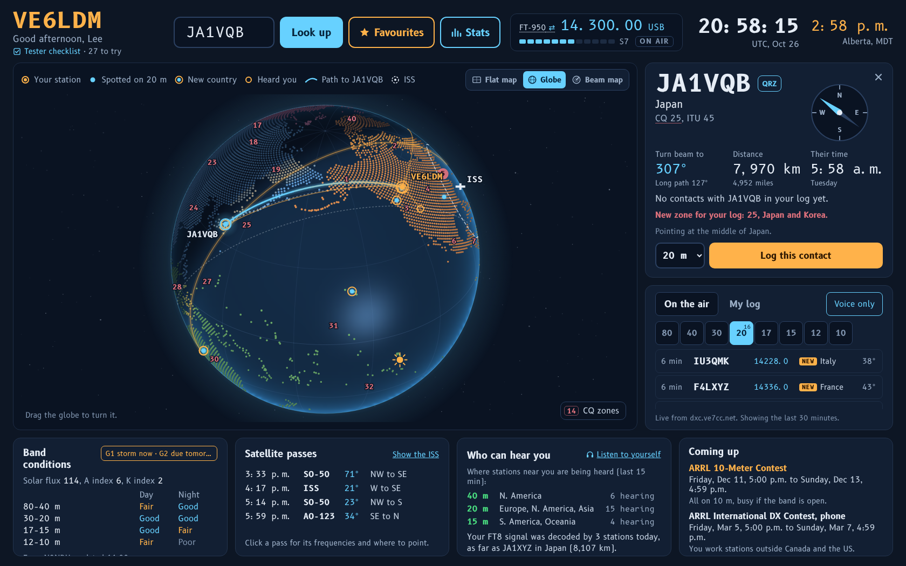
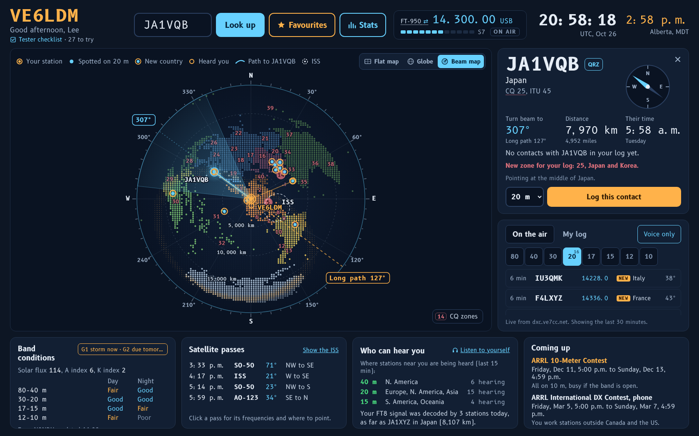
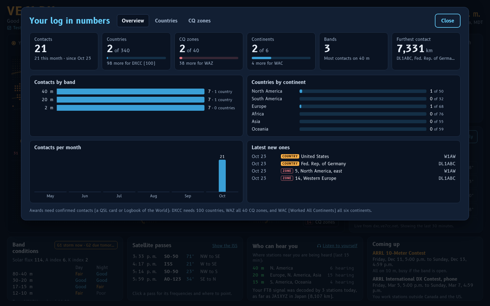
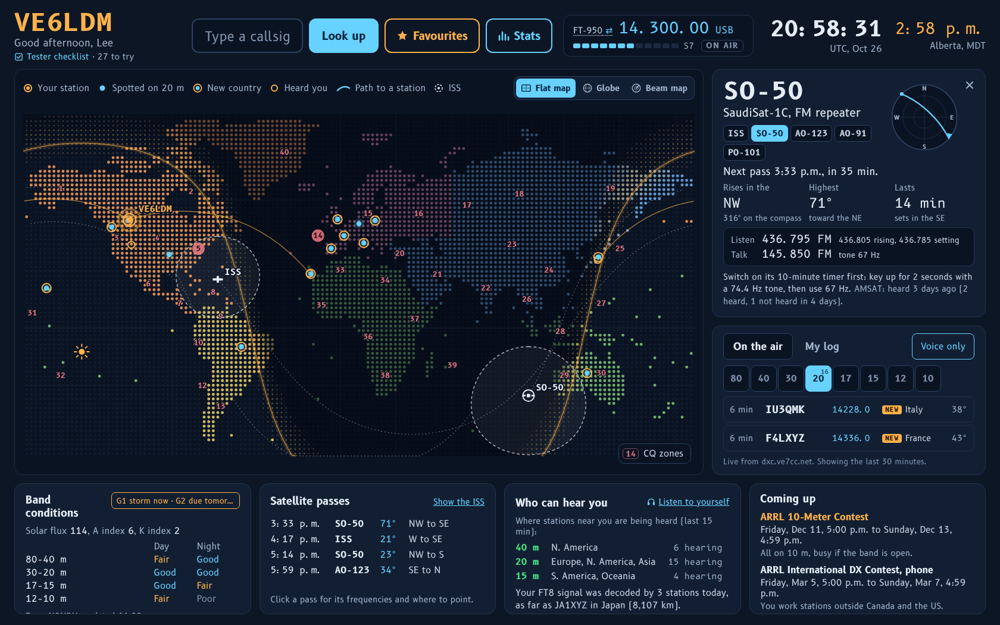
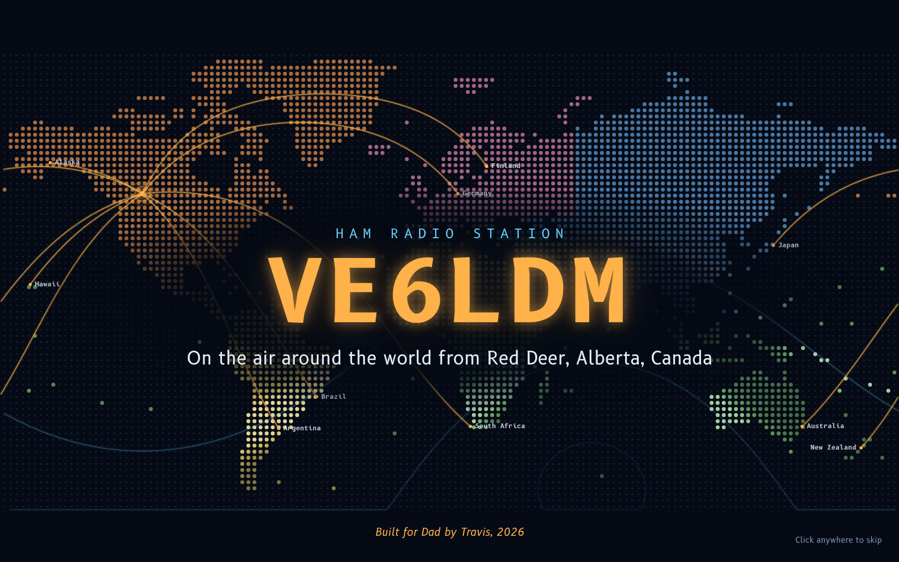
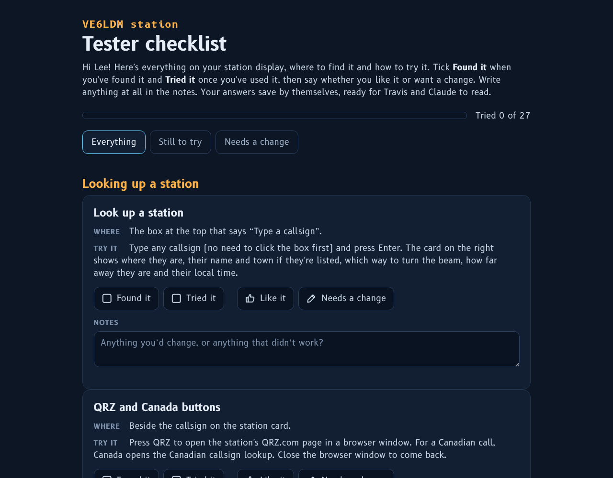

# VE6LDM Ham Radio HUD

A full-screen station display (a "heads-up display") for a ham radio shack. It runs on an
ordinary Linux PC beside the radios and puts everything on one big screen: live DX spots on a
world map, your radio's frequency, who you're looking up and which way to turn the beam, band
conditions, satellite passes, alerts and your logbook.

It was built for **VE6LDM**, Lee's station in central Alberta, Canada, as a gift from his son
Travis. The code was written by Claude, Anthropic's AI model, working with Travis.



> **Work VE6LDM!** Lee operates SSB on the HF bands (80 to 10 metres) from grid square DO32,
> near Red Deer, Alberta. If you hear him, give him a call. He'd be glad of the contact.

## What it does

**On the air**
- Live DX cluster spots for the band you pick, with the country, beam heading and how long ago.
  NEW, ZONE and BAND badges mark a new country, a new CQ zone, or a country that's new on that band.
- It moves to a backup node by itself if a cluster node goes quiet, and tries the first one again every hour.
- Your radio's frequency, mode and S-meter, read through [Hamlib](https://hamlib.github.io/).
  While you transmit, an ON AIR light, the power going out and the SWR.
- **Tune to** sends the radio to a spot's frequency. The app reads and tunes the radio; it never transmits.
- Up to two radios. The display follows the one in use, and **Tune to** picks the radio
  that has an antenna for the band.

**Looking up a station**
- Type any callsign to see where they are, their name and town (with a free HamQTH account),
  the beam heading both ways round, the distance and their local time.
- Three map views: a flat map with the night side and the gray line; a globe that swings round to
  show the path; and a beam map centred on your station, where the angle from the middle is the beam heading.
- Canadian hams are placed in their home towns, from ISED Canada's call sign list.
- QRZ and Canadian call sign look-up buttons open in the web browser.

**Your log**
- Log a contact with one click. The frequency, mode and radio come from the radio itself.
- Save the log as ADIF for Logbook of the World or QRZ.
- Stats: contacts, DXCC countries, CQ zones (toward WAZ), continents and bands, with charts.

**Around the screen**
- Band conditions by day and night, and space weather from NOAA. Weather alerts from Environment Canada
  (Canada only), with a reminder to disconnect the antennas when there's a thunderstorm.
- **Who can hear you:** where signals from stations near you are being heard right now, from
  PSK Reporter's live feed, plus any DX cluster spots of your own call.
- **Listen to yourself:** a public KiwiSDR receiver a good distance away, tuned to your frequency.
- Satellite passes for the ISS and the FM satellites (SO-50, AO-123, AO-91, PO-101), with a sky chart,
  where to point, the frequencies with Doppler steps, and AMSAT's latest reports.
- The big phone contests coming up.
- Your favourite ham websites, one click away.
- Optional: a waterfall from an RTL-SDR tapped into the radio's IF, shown in Gqrx with its scale
  following the radio's dial.

**Small touches**
- A welcome banner when the computer starts, with your callsign and radio waves going out around the world.
- Birthday and licence-anniversary greetings.
- A tester checklist: a tour of everything on the display, where the operator ticks what they've tried
  and leaves notes for whoever looks after the station.

**It looks after itself**
- The display reopens if it's closed, and reloads if its page stops answering.
- The radio link restarts itself when the radio comes back on or its cable is plugged back in.
- The logbook is backed up every night (the last 60 nights, as a copy and as ADIF).
- A helper command lets someone look after the station from another computer over SSH:
  a health report, live screen sharing, updates and settings.

## Screenshots

<table>
<tr>
<td width="50%"><br>The globe swings round to show the path</td>
<td width="50%"><br>The beam map: the angle from the middle is the beam heading</td>
</tr>
<tr>
<td width="50%"><br>Stats from the logbook</td>
<td width="50%"><br>A satellite pass: where to point, and the frequencies</td>
</tr>
<tr>
<td width="50%"><br>The welcome banner at power-up</td>
<td width="50%"><br>The tester checklist</td>
</tr>
</table>

The screenshots are from a test run with sample spots and a sample log.

## What you need

- A Linux PC. It's built and tested on Linux Mint 22 (Xfce). Other Debian- or Ubuntu-based systems
  should work with little or no change.
- A big screen beside the radios. The display is laid out for 1680 x 1050 and scales to other sizes.
  A second screen is optional; at VE6LDM it shows the waterfall and web pages.
- A radio Hamlib can talk to, with its computer (CAT) cable. Without one, the practice radio lets you
  try everything else.
- An internet connection for the spots and the data feeds.
- Optional: a second radio, a free [HamQTH](https://www.hamqth.com) account for names and towns,
  and an RTL-SDR on the radio's IF output for the waterfall.

The app needs only Python 3.9 or newer and its standard library (python3-sgp4 is used for satellite
orbits if it's installed). The display is a web page shown full-screen in Chromium.

## Install

On the station computer, as your normal user:

```sh
git clone https://github.com/piconova111/ve6ldm-ham-radio-hud.git
cd ve6ldm-ham-radio-hud
./install.sh
~/station/app/bin/setup.sh
```

The installer adds the system packages it needs (Chromium, Hamlib, curl and a few X tools; it asks
for your password), copies the app to `~/station/app`, makes `~/station/config.ini`, downloads the
country file and the display fonts, and sets up background services that start the app, the radio
link, the display and the nightly backup. To update later, run `git pull` and then `./install.sh` again:
it updates the app in place and keeps your settings and your log.

The setup helper then walks through your callsign and name, your location, your radio (it finds the
Hamlib model, the cable and the speed the radio answers at), the optional HamQTH callbook, optional
remote access with Tailscale, and automatic login so the display comes up by itself after power-on.

To try the display without a radio, set `model = 1` under `[radio]` in `~/station/config.ini`
(Hamlib's practice radio), then restart the app.

## Settings

Everything lives in `~/station/config.ini`, and every line has a note above it.
[config.example.ini](config.example.ini) shows them all. After a change:

```sh
systemctl --user restart station-app station-rigctld station-rigctld2
```

The main ones:

| Section | What it sets |
|---|---|
| `[station]` | Your callsign, name, location (grid square or latitude and longitude), time zone and zones |
| `[radio]`, `[radio2]` | Each radio's Hamlib model, cable, speed, power and the bands it has antennas for |
| `[cluster]` | The DX cluster node and the backups to move to |
| `[display]` | Zone numbers, voice-only spots, the globe on look-up, the welcome banner, the checklist |
| `[personal]` | Licence anniversary, birthday, a note on your own card, and who reads the checklist notes |
| `[alerts]` | Environment Canada alert area and NOAA space weather |
| `[satellites]` | Which FM satellites to show |
| `[openings]` | PSK Reporter's live feed on or off |
| `[waterfall]` | The optional SDR waterfall and the radio's IF frequency |

[HELP.txt](HELP.txt) is the handy-commands sheet: it's copied to `~/station/HELP.txt` on the station.

## Looking after a station from another computer

`remote/station` is a small command for another Linux computer (a Raspberry Pi works well).
Install it with `sudo install -m 755 remote/station /usr/local/bin/station`. The first time you run it,
it asks which station computer to look after (`user@name`, the way you'd type it after `ssh`).

```text
station status     health report: app, radio links, spots, backups, version
station screen     see the station display live (needs tigervnc-viewer)
station update F   install a new version from a package file
station settings   edit config.ini, then restart the app
station feedback   the tester checklist's answers and notes
station backups    copy the logbook backups to this computer
```


## Safe by design

- The app never transmits. Hamlib's transmit command is never sent; the radio link only reads the
  radio and sets its frequency and mode when you press **Tune to**.
- The app only listens on the station computer itself (127.0.0.1), so nothing on the network can reach it.
- The display can only ask the app to open one of its own links (favourites, look-up sites, alert pages,
  KiwiSDR receivers from the public list), never an address of its own.
- What leaves the computer: your callsign, to sign in to the DX cluster and to follow reports of your own
  signal on PSK Reporter's feed; the grid squares around you, for the band openings; look-ups to HamQTH
  if you set up an account; and requests for the public data below. Your log stays on the station computer.

## Thanks to

The display stands on the work of many hams and organisations who share their data:

- [AD1C's country files](https://www.country-files.com) for DXCC countries, zones and prefixes
- The DX cluster node operators, including VE7CC, NC7J, K1TTT and W3LPL
- N0NBH's solar data at [hamqsl.com](https://www.hamqsl.com) for band conditions
- [PSK Reporter](https://pskreporter.info) and M0LTE's live feed at mqtt.pskreporter.info
- [KiwiSDR](http://kiwisdr.com) receiver owners, and the public list at rx.linkfanel.net
- [CelesTrak](https://celestrak.org) for satellite orbits, and [AMSAT](https://www.amsat.org) for satellite reports
- [NOAA's Space Weather Prediction Center](https://www.spaceweather.gov)
- [Environment and Climate Change Canada](https://weather.gc.ca) for weather alerts
- ISED Canada's amateur call sign list (Open Government Licence - Canada) and
  [GeoNames](https://www.geonames.org) postal codes (CC BY 4.0) for Canadian home towns
- [Natural Earth](https://www.naturalearthdata.com) (public domain) for the coastlines
- EI8IC's CQ zone list at [mapability.com](https://www.mapability.com) for checking the zone map
- [HamQTH](https://www.hamqth.com), [Hamlib](https://hamlib.github.io/) and [Gqrx](https://www.gqrx.dk)
- The B612 fonts by Airbus and Intactile Design (SIL Open Font License), downloaded at install time

## Who made it

- **Lee, VE6LDM:** the station it was built for, its first tester, and the reason it exists.
- **Travis Matheson:** the idea, the hardware, the installs in Lee's shack, and every round of
  testing, feedback and new ideas.
- **Claude**, an AI model made by [Anthropic](https://www.anthropic.com): wrote the software, working
  with Travis over many conversations in the fall of 2026. That's the station app and its display,
  the maps and the globe, the radio links, the logbook and stats, the data feeds, the installer,
  the setup and remote helpers, and these docs.

## Licence

MIT. See [LICENSE](LICENSE).
